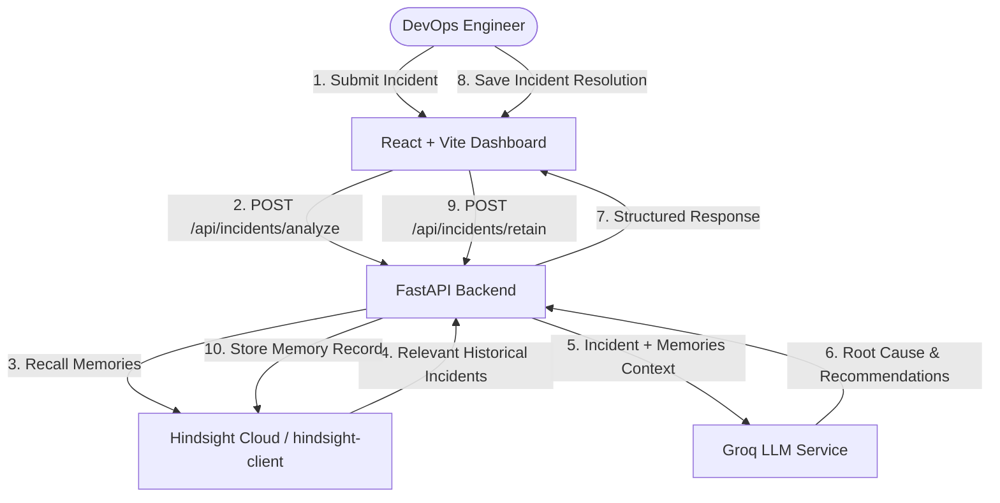

# MemoryOps ⚡ AI Incident Response Agent with Hindsight Memory

**MemoryOps** is a production-ready DevOps Incident Response & Site Reliability Engineering (SRE) Agent. It integrates the **Hindsight Memory System** to store and recall past production incident resolutions, providing context-aware AI incident diagnostics.

---

## 🚀 The Core Product Story

Standard AI chatbots diagnose incidents using generic language models without historical context. **MemoryOps** solves this by using **Hindsight** as its long-term biomimetic memory engine:

```
WITHOUT MEMORY  ➡️  Generic, unverified SRE suggestions ("No relevant historical memory found.")
WITH HINDSIGHT  ➡️  Instant root cause analysis & proven remediation from past incident resolutions
```

---

## 🛠️ Tech Stack

- **Frontend**: React 18, Vite, Tailwind CSS, Lucide Icons
- **Backend**: Python 3.13, FastAPI, Uvicorn, Pytest, Pydantic V2
- **Memory Engine**: Hindsight Cloud / `hindsight-client` Python SDK
- **LLM**: Groq API (`llama-3.3-70b-versatile` / fallback engine)
- **Deployment**: Vercel (Frontend), Render / Railway / Docker (Backend)

---

## 🏛️ System Architecture



---

## 📁 Directory Structure

```
MemoryOps/
├── backend/
│   ├── main.py                 # FastAPI endpoints & CORS configuration
│   ├── hindsight_service.py    # Hindsight SDK wrapper (retain, recall, format, fallback)
│   ├── llm_service.py          # Groq LLM prompt design & structured JSON analysis
│   ├── incident_service.py     # Orchestration connecting Hindsight & Groq
│   ├── requirements.txt        # Python dependencies
│   ├── .env.example            # Environment template
│   └── tests/
│       ├── test_health.py      # Health API unit test
│       ├── test_hindsight.py   # Hindsight retain/recall tests
│       └── test_incidents.py   # E2E incident analysis & retain tests
├── frontend/
│   ├── src/
│   │   ├── components/
│   │   │   ├── Header.jsx          # DevOps Header with Hindsight Status
│   │   │   ├── IncidentInput.jsx   # Form input & realistic incident presets
│   │   │   ├── AnalysisPanel.jsx   # AI Root Cause, Actions, & Confidence
│   │   │   ├── MemoryPanel.jsx     # Retrieved Hindsight historical memories
│   │   │   ├── ResolutionPanel.jsx # Retain resolution back into Hindsight
│   │   │   └── BeforeAfterDemo.jsx # Interactive BEFORE vs AFTER memory proof
│   │   ├── services/
│   │   │   └── api.js              # Fetch client for FastAPI backend
│   │   ├── App.jsx                 # Dashboard state manager
│   │   └── index.css               # Tailwind & DevOps theme styling
│   ├── package.json
│   └── vite.config.js
├── docs/
│   ├── architecture.md         # Deep dive architecture doc
│   └── demo-script.md          # 3-minute video/demo presentation script
├── .gitignore
└── README.md
```

---

## ⚙️ Environment Variables Setup

Create a `.env` file inside `backend/`:

```env
# Hindsight Cloud Configuration
HINDSIGHT_API_URL=https://api.hindsight.vectorize.io
HINDSIGHT_API_KEY=your_hindsight_api_key_here
HINDSIGHT_BANK_ID=memoryops-incidents

# Groq LLM Configuration
GROQ_API_KEY=your_groq_api_key_here
GROQ_MODEL=llama-3.3-70b-versatile

# Backend Server
PORT=8000
HOST=0.0.0.0
```

> [!NOTE]
> `MemoryOps` includes an automatic fallback engine. If `GROQ_API_KEY` or `HINDSIGHT_API_KEY` are not set during local offline testing, all endpoints and tests continue to work cleanly!

---

## 🚀 Running Locally

### 1. Start the Backend API (FastAPI)

```bash
cd backend
python -m venv venv
# On Windows:
.\venv\Scripts\activate
# On Linux/macOS:
source venv/bin/activate

pip install -r requirements.txt
python main.py
```

FastAPI server runs at: `http://localhost:8000`  
Swagger API Docs available at: `http://localhost:8000/docs`

### 2. Start the Frontend Dashboard (React + Vite)

```bash
cd frontend
npm install
npm run dev
```

Frontend UI runs at: `http://localhost:3000`

---

## 🧪 Running Backend Test Suite

Run the automated test suite with `pytest`:

```bash
cd backend
.\venv\Scripts\pytest tests
```

Output: `10 passed in 15.15s`

---

## 💡 Hindsight SDK Integration

### Retaining Memories (`client.retain`)

When an incident is resolved, MemoryOps formats the experience and stores it into Hindsight bank `memoryops-incidents`:

```python
from hindsight_client import Hindsight

client = Hindsight(api_key="your_hindsight_api_key")

client.retain(
    bank_id="memoryops-incidents",
    content="[INCIDENT MEMORY RECORD]\nIncident ID: PAY-001\nService: Payment API\nSymptoms: HTTP 504 Gateway Timeout\nRoot Cause: Database connection pool exhaustion\nResolution: Increased connection pool size from 20 to 100",
    document_id="PAY-001"
)
```

### Recalling Memories (`client.recall`)

When a new incident occurs, MemoryOps recalls past experience:

```python
memories = client.recall(
    bank_id="memoryops-incidents",
    query="Payment API returning HTTP 504"
)
```

---

## ⚡ BEFORE vs. AFTER Demonstration

Use the **Before vs. After Memory Demo** tab in the dashboard to demonstrate the transformation:

1. **BEFORE MEMORY**: Submit `"Payment API returning HTTP 504"`. The AI notes: `"No relevant historical memory was found."`
2. **STORE MEMORY**: Commit `PAY-001` resolution into Hindsight using `retain()`.
3. **AFTER MEMORY**: Re-submit `"Payment API latency spike with HTTP 504"`. Hindsight recalls `PAY-001` and the AI immediately recommends applying the proven database connection pool fix!

---

## 📜 License

MIT License - free for open-source and commercial use.
